<p align="center">
<a href="../../README.md"></a>
<a href="README.en.md"></a>
<a href="README.be.md"></a>
<a href="README.zh.md"></a>
<a href="README.de.md"></a>
<a href="README.fr.md"></a>
<a href="README.es.md"></a>
<a href="README.tr.md"></a>
<a href="README.ko.md"></a>
</p>

<p align="center">
<a href="https://github.com/okeydw/SoundCloud-Android/releases/latest">

</a>
</p>

<h1 align="center">SoundCloud Android</h1>

<p align="center">
<b>[<a href="https://github.com/zxcloli666/SoundCloud-Desktop">Masaüstü sürümü</a>] · [<a href="https://github.com/okeydw/SoundCloud-Android/tree/ios">iOS sürümü</a>]</b><br>
<b>Android için resmi olmayan SoundCloud istemcisi</b><br>
Reklamsız · Captcha yok · Sansür yok · Rusya'da kullanılabilir
</p>

<p align="center">
<a href="https://github.com/okeydw/SoundCloud-Android/releases/latest">

</a>

<a href="https://github.com/okeydw/SoundCloud-Android/releases">

</a>

<a href="../../LICENSE">

</a>
</p>

<p align="center">
<a href="https://github.com/okeydw/SoundCloud-Android/releases/latest">

</a>
</p>

---

## Bu nedir?

**SoundCloud Android**, telefon için yerel bir SoundCloud istemcisidir. [SoundCloud-Desktop](https://github.com/zxcloli666/SoundCloud-Desktop) ile senkronizedir.

**Kotlin + Jetpack Compose + Media3** ile yazıldı, yerel olarak çalışır ve çok az kaynak kullanır.

İstemcinin iki sürümü var, özellikleri aynı, yalnızca görünüm farklı:

> `SoundCloud Full` - masaüstü sürümü tarzında Glass tasarım, parlak görünümü seven ve güçlü telefonu olanlar için.

> `SoundCloud Lite` - ilk sürümlerde kullanılan sade arayüz, minimalizmi seven veya daha zayıf telefonu olanlar için.

### [iOS sürümü (beta)](https://github.com/okeydw/SoundCloud-Android/tree/ios)

---

## İndir

[Sürümler sayfasına](https://github.com/okeydw/SoundCloud-Android/releases/latest) git ve ihtiyacın olan `.apk` dosyasını indir:

| Dosya | Sürüm |
| --- | --- |
| `SoundCloud-Full-vX.Y.Z.apk` | SoundCloud, Glass tasarım |
| `SoundCloud-Lite-vX.Y.Z.apk` | SoundCloud Lite, sade arayüz |

**Kurulum:** indirilen dosyayı telefonda aç ve bilinmeyen kaynaklardan kuruluma izin ver. Sonraki güncellemeler uygulamanın içinden kurulur.

**Gereksinimler:** Android 8.0 (Oreo) veya daha yeni.

---

## Nasıl giriş yapılır

Ardından giriş gelir: SoundCloud üzerinden ya da masaüstü sürümündeki QR kodla.

1. **Masaüstünden QR (önerilen).** [SoundCloud-Desktop](https://github.com/zxcloli666/SoundCloud-Desktop) içinde Ayarlar -> Hesap -> Oturumu başka cihaza aktar bölümünü aç, ardından QR kodu tara.
2. **Telefondan QR.** Giriş ekranında "Giriş için QR göster"e dokun ve zaten giriş yaptığın yerde tara.
3. **Tarayıcı ile.** "Tarayıcı ile giriş yap" düğmesi normal SoundCloud girişini açar. Daha sonra başka bir yerde giriş yaparsan bu oturum düşebilir.

---

## Ekran görüntüleri

> Arka plan, vurgu ve metin renkleri RGB paletiyle değiştirilebilir. Arka plan resmi ve efektler de eklenebilir.

### SoundCloud (Full)

<p align="center">

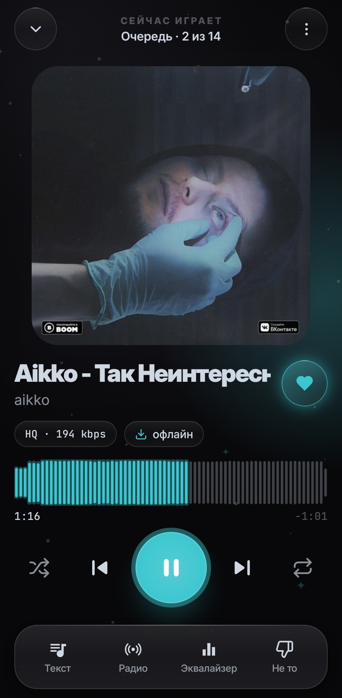
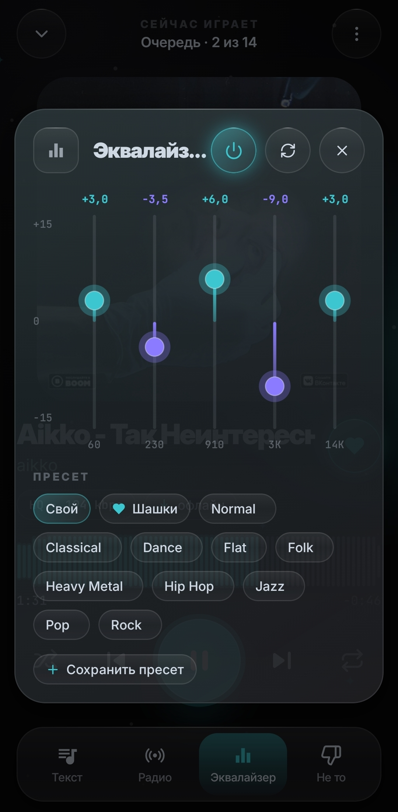
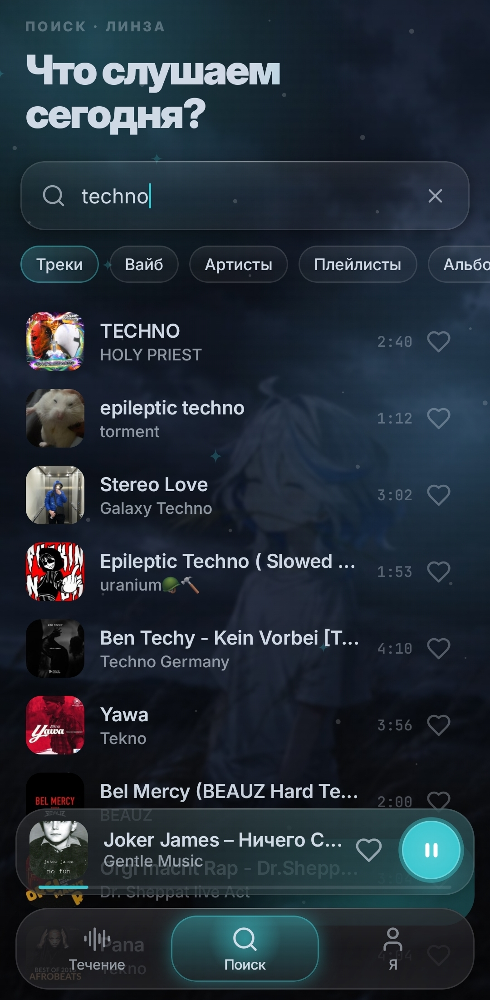
</p>
<p align="center">
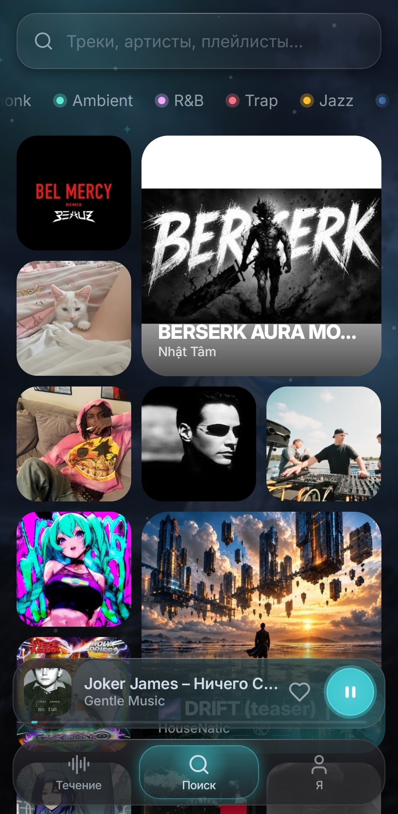


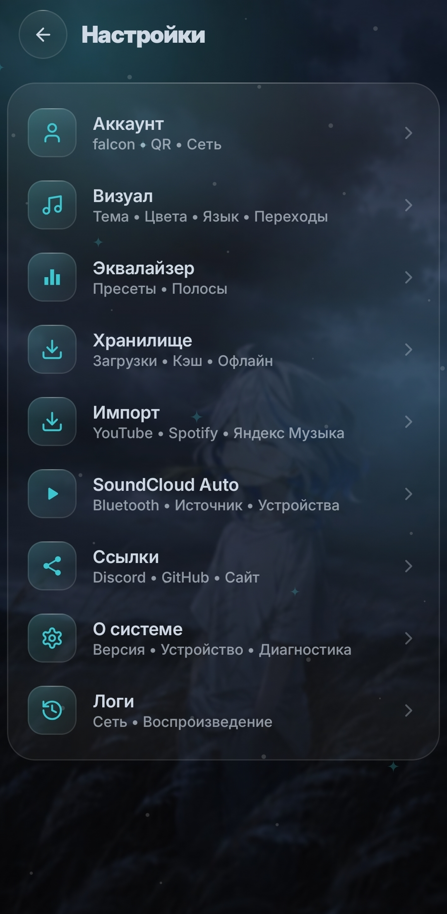
</p>

### SoundCloud Lite

<p align="center">
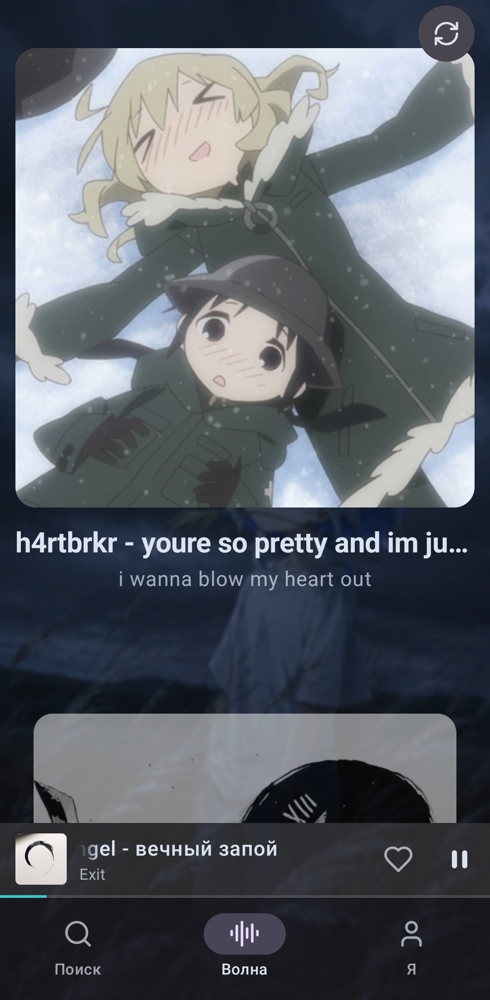
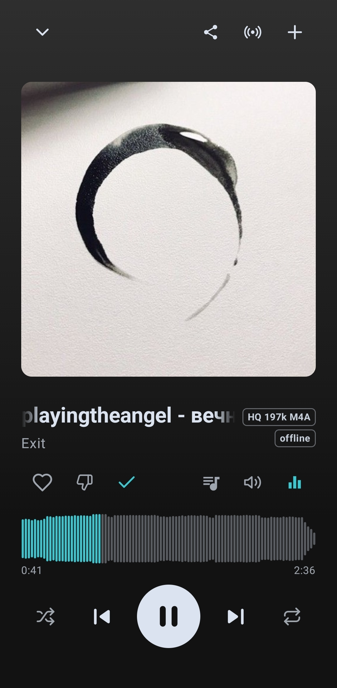
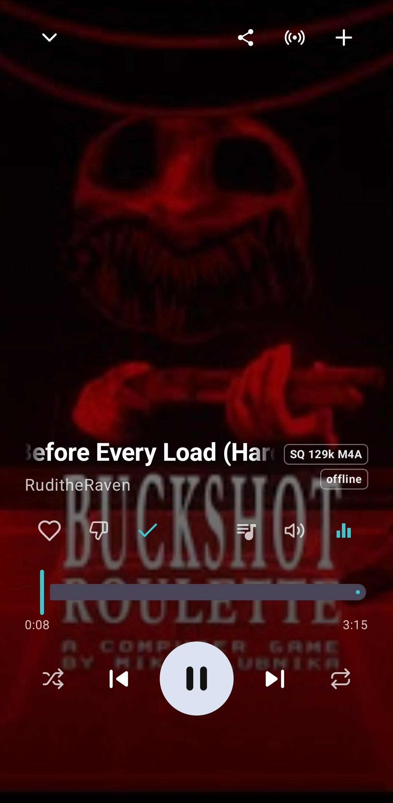
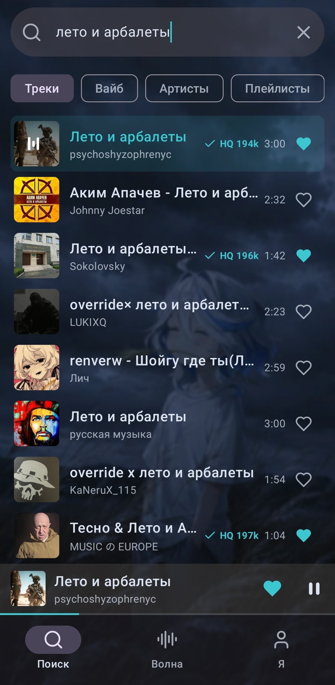
</p>
<p align="center">
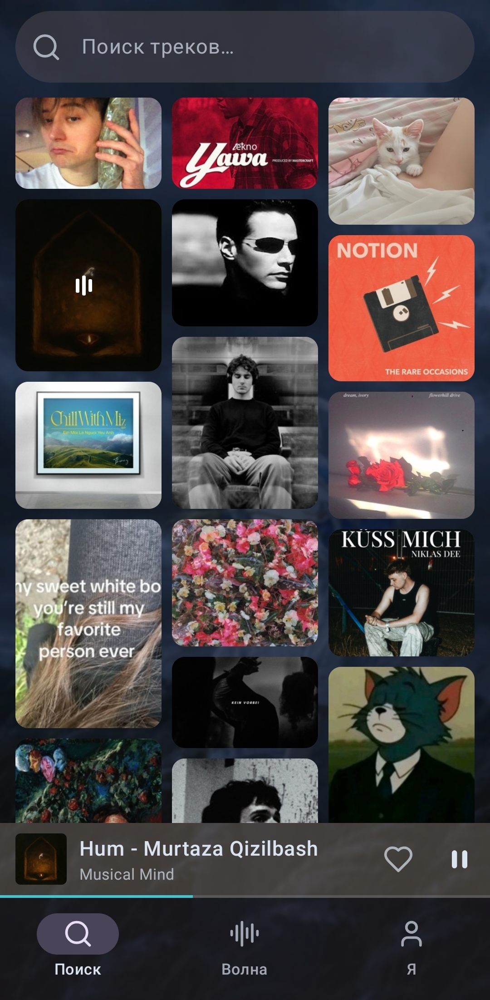
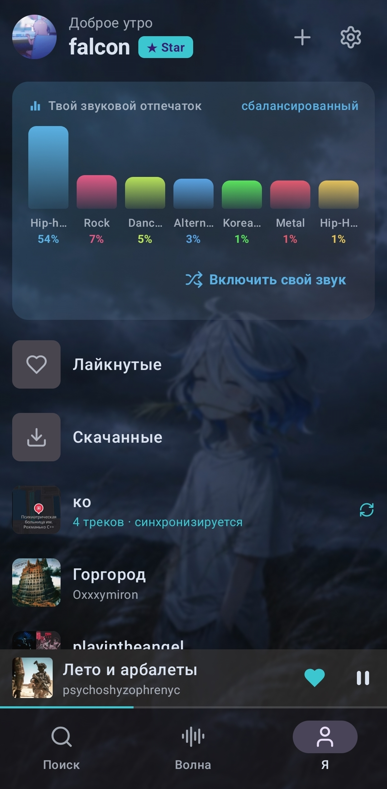
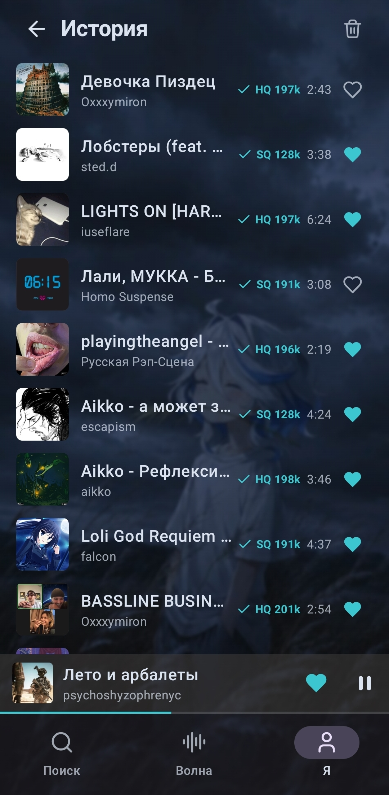
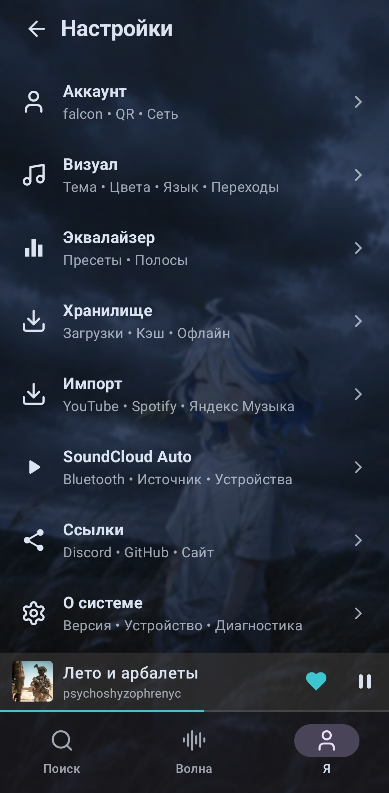
</p>

---

## Özellikler

### Müzik

- **Dalga ve öneriler** - beğenilere ve dinleme geçmişine dayanan kendi öneri sistemimiz
- **Arama** - parçalar, sanatçılar, çalma listeleri, albümler ve vibe araması (bir sinir ağı bağlama göre parça seçer)
- **Oynatıcı** - karıştırma, tekrar, sıra, şarkı sözleri, beğeni ve beğenmeme
- **Ekolayzır** - hazır ön ayarlar ve kendi ön ayarını oluşturma
- **Çalma listeleri** - SoundCloud ile senkronize kendi yerel listelerin, herkese açık veya gizli, parça sırası sürükleyerek değişir ve kaydedilir
- **Geçmiş ve istatistikler** - dinleme süresi, en çok dinlenen parçalar ve sanatçılar, günlere ve saatlere göre grafik
- **Profiller** - takip etme ve takibi bırakma, SoundCloud profilindeki bağlantılar
- **SoundCloud Auto (beta)** - Bluetooth cihazlara bağlanma senaryoları oluşturma

### Çevrimdışı mod

- Parça ve çalma listesi indirme, önbellekli çevrimdışı mod
- Önbellek sınırını ve temizlenme zamanını elle ayarlama
- İki sürüm de kuruluysa Full ve Lite arasında ortak indirmeler ve listeler (beta, kısmen çalışır)

### İçe aktarma (beta)

- **YouTube / YouTube Music** - Google hesabıyla beğeniler, çalma listeleri ve albümler
- **Yandex Music** - token ile beğeniler, çalma listeleri ve albümler
- **Spotify** - client_id ile beğeniler, çalma listeleri ve albümler

###### [Ayrıntılar](../import-lang/import.tr.md)

> Önemli!!! Sesin kendisini aktarmıyoruz, benzer parçaları arıyoruz
> (ama bu sayede sansür aşılabiliyor, fck censor)

---

## Geri bildirim
Topluluk: [Discord](https://discord.gg/Au3ebtfYu3)

Bir hata buldun ya da bir fikrin mi var? En kolayı "Ayarlar -> Sistem hakkında -> Destek": GitHub'da issue ya da Discord'da destek talebi aç, cihaz bilgileri otomatik eklenir. İstersen doğrudan [issue açıp](https://github.com/okeydw/SoundCloud-Android/issues/new/choose) günlükleri ekleyebilirsin: "Ayarlar -> Günlükler -> Paylaş".

---

## Teknolojiler

| Katman | Teknolojiler |
| --- | --- |
| Dil | Kotlin |
| UI | Jetpack Compose, Material 3, Haze (Full'da cam efekti) |
| Ses | Media3 (ExoPlayer + MediaSession), bildirimli arka plan servisi |
| Ağ | OkHttp (+ disk önbelleği), kotlinx.serialization |
| Görseller | Coil (+ kapağa göre renklendirme için Palette) |
| Kamera | CameraX + ML Kit (Full'da QR tarayıcı), ZXing |
| Depolama | SharedPreferences (ayarlar, oturum), indirmeler ve listeler için JSON dizinleri |

Backend: [SoundCloud-Backend](https://github.com/zxcloli666/SoundCloud-Backend).

Sunucu durumu [burada](https://status.soundcloud-desktop.fun/)

**Uyumluluk:** `minSdk 26` (Android 8.0), `targetSdk 35`, `compileSdk 35`.

Tüm değişiklikler [CHANGELOG.md](../../CHANGELOG.md) dosyasında.

---

## Geliştiriciler için

**Derleme:** JDK 17, Android SDK 35.

```bash
./gradlew assembleLiteDebug assembleFullDebug   # APK app/build/outputs/apk/<flavor>/debug/ içinde
./gradlew testLiteDebugUnitTest                 # birim testleri
./gradlew lintLiteDebug                         # lint (baseline ile: ./gradlew updateLintBaseline)
```

**Kaynak kod:**

| Klasör | İçerik |
| --- | --- |
| `app/src/main` | mantık: API, oynatıcı, indirmeler, listeler, içe aktarma |
| `app/src/shared` | ortak ekranlar ve diyaloglar (ayarlar vb.) |
| `app/src/lite` | Lite arayüzü |
| `app/src/full` | Full'un Glass arayüzü |

**Sürüm:** `vX.Y.Z` etiketi (`versionName` ile aynı olmalı) iki sürümü tek anahtarla derleyip imzalar ve `CHANGELOG.md` açıklamasıyla yayınlar.

**Backend:**

| Alan adı | Amaç |
|---|---|
| `api.scnative.space`, `api-star.scnative.space` | API |
| `stream.scnative.space`, `stream-star.scnative.space` | ses |
| `storage.scnative.space`, `storage-star.scnative.space`, `s3.scnative.space` | parça deposu |
| `images.scnative.space` | kapaklar |
| `pay.scnative.space` | STAR ödemesi |
| `health.scnative.space` | bağlantı kontrolü |
| `call-*.scnative.space` | "Kullanıcı ağı" |
| `*.relay.scnative.space` | yedek rotalar |
| `soundcloud.com`, `api-v2.soundcloud.com`, `*.sndcdn.com` | parçayı doğrudan SoundCloud'dan indirme |

QR ile giriş protokolü: masaüstü deposundaki [qr-link-protocol.md](https://github.com/zxcloli666/SoundCloud-Desktop/blob/main/docs/qr-link-protocol.md).

---


## Lisans

MIT. Ayrıntılar [LICENSE](../../LICENSE) dosyasında.

_SoundCloud, SoundCloud Ltd.'nin ticari markasıdır. Bu uygulamanın SoundCloud ile bir bağlantısı yoktur._

---

<p align="center">
<a href="https://github.com/okeydw/SoundCloud-Android/releases/latest">

</a>
</p>

<p align="center">
<code>soundcloud android</code> · <code>soundcloud apk</code> · <code>soundcloud istemcisi</code> · <code>android için soundcloud</code> · <code>reklamsız soundcloud</code> · <code>soundcloud engellendi</code> · <code>soundcloud çalışmıyor</code> · <code>soundcloud android app</code> · <code>soundcloud player</code> · <code>soundcloud apk download</code> · <code>soundcloud alternative client</code> · <code>soundcloud no ads</code> · <code>soundcloud müzik çalar</code>
</p>

<p align="center">
<a href="https://github.com/okeydw/SoundCloud-Android/releases/latest">

</a>
</p>
